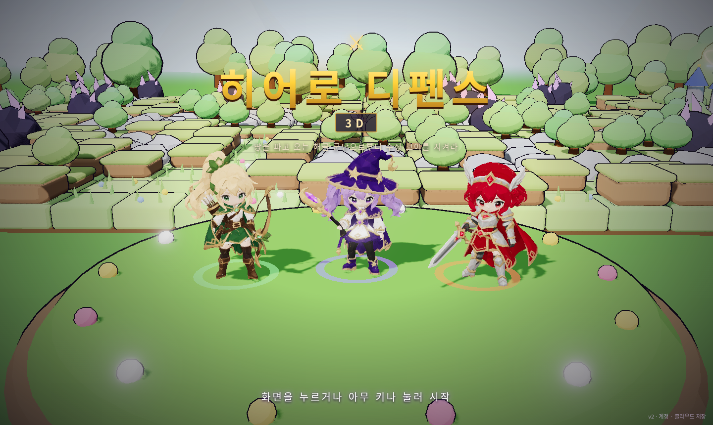
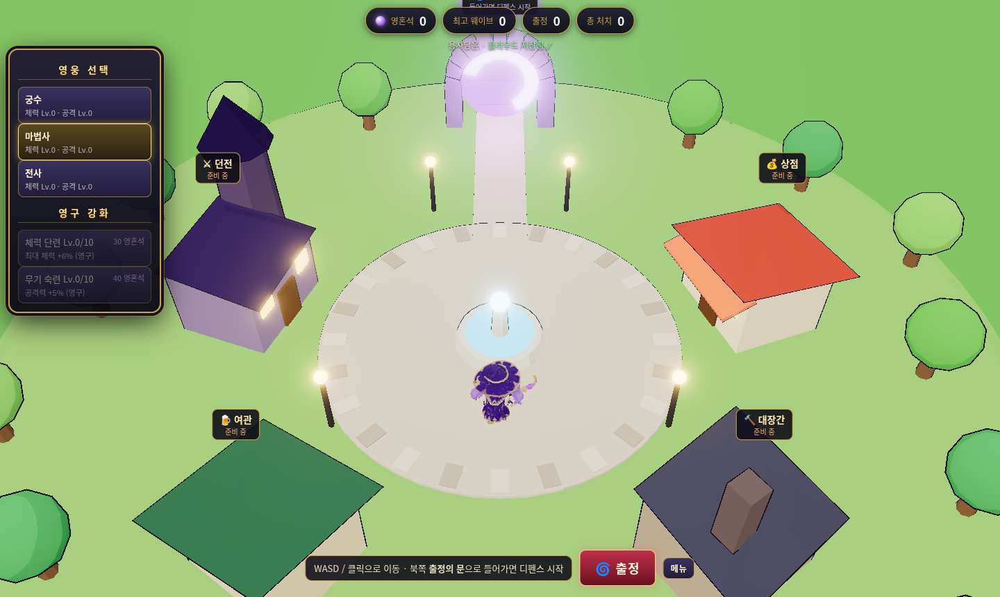
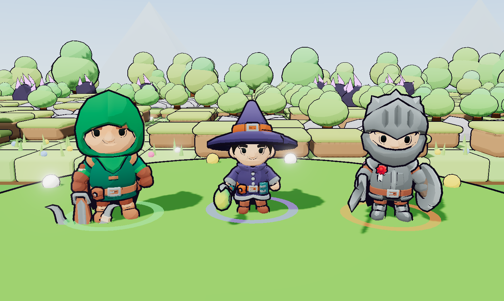
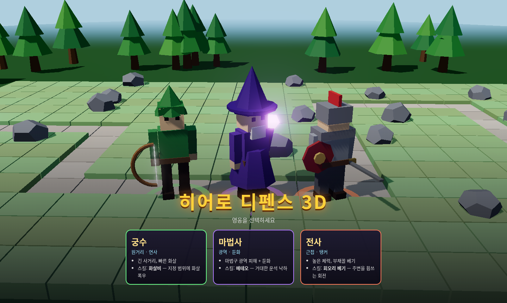
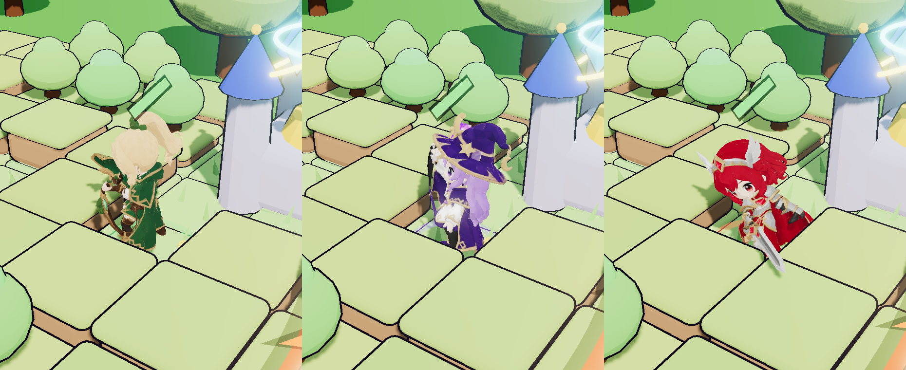
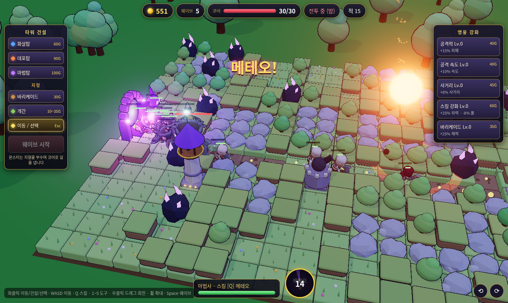
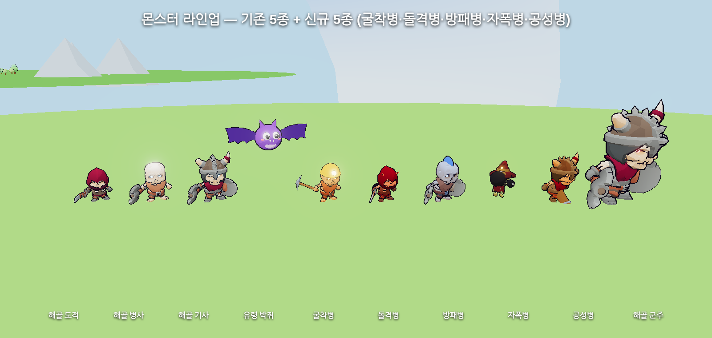
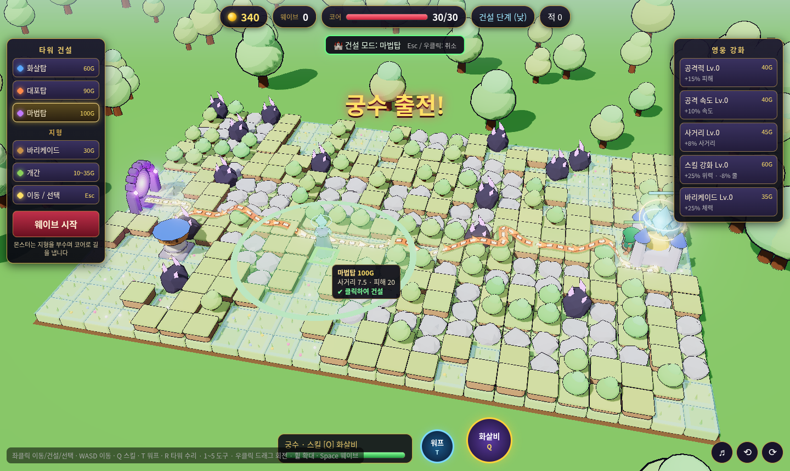
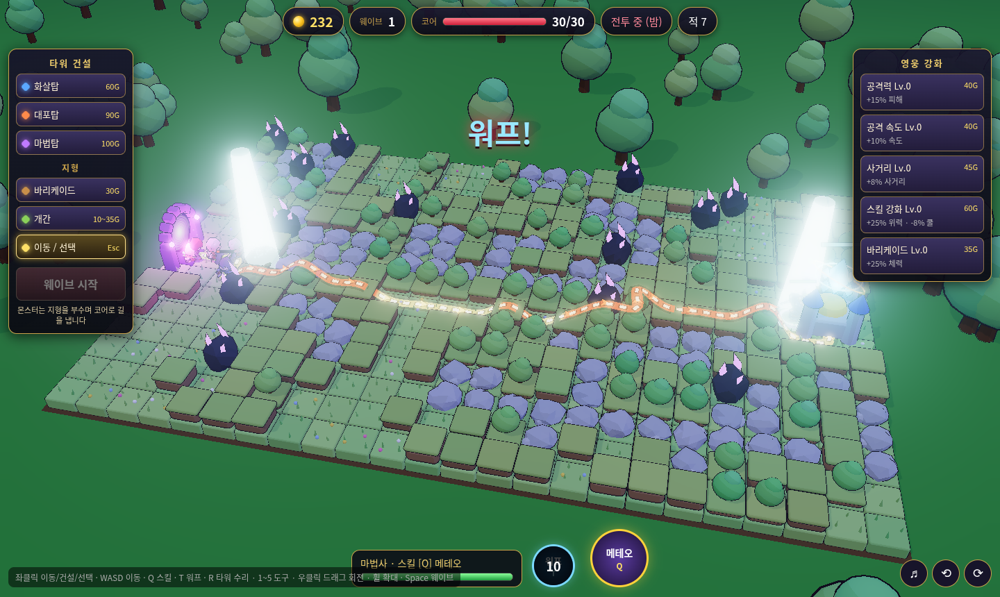

# 히어로 디펜스 3D

Three.js(로컬 번들, CDN 없음)로 만든 쿼터뷰 3D 웹 디펜스 게임.

**플레이:** https://hyunjk11.github.io/hero-defense-3d/

## 게임 방식
- 맵 전체가 **파괴 가능한 지형**(흙더미·숲·바위, 일부 파괴 불가 암반)으로 덮여 있습니다.
- 몬스터는 포털에서 나와 지형을 **부수고 파내며** 코어로 전진합니다(파기/내려치기 애니메이션, 파편).
  파낸 자리는 **참호 길**로 남아 다음 적들이 이용합니다.
- 경로 비용 = 거리 + 블록 체력. 이미 뚫린 길이 더 싸면 그 길을, 아니면 새로 팝니다(다익스트라 거리장).
- **타워(골드)**: 빈 잔디 칸에 건설 · 3단계 업그레이드(단계마다 외형 변화) · 판매(70% 환급)
  - 화살탑: 빠른 단일 공격(공중 가능) · 대포탑: 포물선 포탄 범위 피해 · 마법탑: 연쇄 번개 + 둔화
- **바리케이드**: 뚫린 길 위에 설치해 적을 막는 장애물(적이 부수거나 돌아감)
- **개간**: 골드로 블록을 치워 타워 자리를 확보
- **영웅**(궁수/마법사/전사)을 직접 조종하며 싸움 · 스킬 Q · 사망 시 5초 후 부활
- 해골 도적/병사/기사, 유령 박쥐(비행), 5웨이브마다 해골 군주 보스
- **워프(T)**: 1초 채널링 후 코어 앞으로 순간이동(쿨다운 10초, 이동 시 취소) · 끼임 자동 탈출
- 건설 미리보기: 고스트 타워·사거리·비용·불가 사유, 개간 블록 강조, 건설 가능 칸 격자, Esc/우클릭 취소
- 신규: 굴착병·돌격병·방패병·자폭병·공성병 (CHANGELOG.md 참고), 타워 체력·수리(R)
- 툰 셰이딩 + 외곽선, 블룸, 그림자, 낮(건설)/밤(전투), 파티클, 데미지 숫자, 코인 연출
- 몬스터 길 표시: 파낸 참호 바닥 발광 + 가장자리 빛 테두리, 예상 경로 리본(점선, 파야 할 구간은 주황), 코어로 흐르는 화살표
- HP 바: 영웅/적/보스/바리케이드/코어 공통 빌보드 바 (같은 왼쪽 기준점, 피해 잔상 바), 화면 상단 보스 체력 바
- 사운드: 건설(평화) / 전투(긴장) / 보스(격렬) BGM 크로스페이드, 공격·스킬·피격·파괴·채굴·코인·건설·강화·판매·웨이브 뿔나팔·보스 포효·코어 피격·게임오버 효과음
  - 우하단 ♪ 버튼에서 BGM/효과음 볼륨·음소거 따로 설정(localStorage 저장), M 키 전체 음소거. 첫 클릭/키 입력 때 오디오 시작

조작: 좌클릭 이동/건설/선택 · WASD 이동 · Q 스킬 · T 워프 · 1~5 도구 · 우클릭 드래그 회전 · 휠 확대 · Space 웨이브 시작 · Esc 취소 · M 음소거

## 계정 · 클라우드 저장 · 화면 흐름
인트로(세 영웅 3D 무대) → 로그인(이메일/비밀번호, 회원가입, 게스트) → 메인 메뉴(이어하기/새로 시작/설정/닉네임) → **마을**(걸어다니는 3D 마을, 영웅 선택, 영혼석으로 영구 강화, 던전·상점·대장간·여관은 준비 중) → **출정의 문**으로 기존 디펜스 시작 → 패배/귀환 시 보상(영혼석 = 웨이브×8 + 처치/3)을 저장하고 마을로.
- Supabase(cart-race와 같은 프로젝트)의 `hd3d_profiles`, `hd3d_progress` 테이블 사용. **최초 1회 `supabase/schema.sql`을 Supabase SQL Editor에서 실행해야** 클라우드 저장이 켜집니다(실행 전에는 '서버 준비 중' 표시 + 이 기기에 저장).
- 저장은 디바운스 + 오프라인 재시도, 기기에서 첫 로그인 시 게스트 진행을 병합. `?test`/`?skipintro`는 기존 영웅 선택 화면으로 바로 시작.

## 크레딧
- 영웅 모델·애니메이션(궁수·마법사·전사, 모두 여성 치비 캐릭터): **Meshy**로 생성한 AI 생성 에셋 (Image to 3D + 자동 리깅 + 애니메이션 라이브러리, meshopt 압축 + 1024 WebP, three.js MeshoptDecoder로 로드)
- 캐릭터·무기 모델: **KayKit Adventurers & KayKit Skeletons Character Packs** by Kay Lousberg
  (https://www.kaylousberg.com) — **CC0 1.0**. `models/`에 용량을 줄여 포함했습니다.
- 효과음: Kenney (https://www.kenney.nl) — RPG Audio, Impact Sounds, Interface Sounds, Sci-fi Sounds, Music Jingles, **CC0 1.0** (`audio/sfx/`, `audio/KENNEY_LICENSE.txt`)
- BGM (모두 **CC0**, OpenGameArt.org):
  - 건설 단계: "Town Theme RPG" by cynicmusic — https://opengameart.org/content/town-theme-rpg (`audio/bgm/town.mp3`)
  - 전투: "Battle Theme A" by cynicmusic — https://opengameart.org/content/battle-theme-a (`audio/bgm/battle.mp3`)
  - 보스: "Boss Battle Theme" by CleytonKauffman — https://opengameart.org/content/boss-battle-theme (`audio/bgm/boss.mp3`)
- 웨이브 뿔나팔·보스 포효·번개 지직 소리는 WebAudio로 직접 합성
- 엔진: [three.js](https://threejs.org) (MIT)
