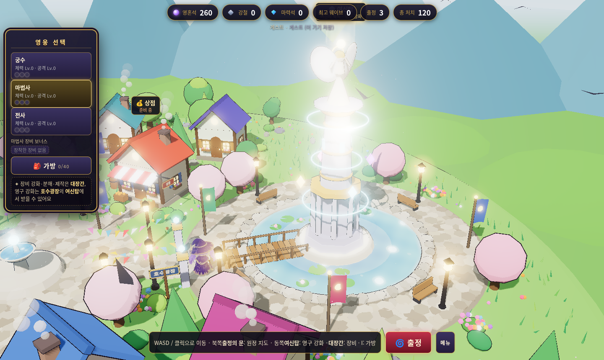
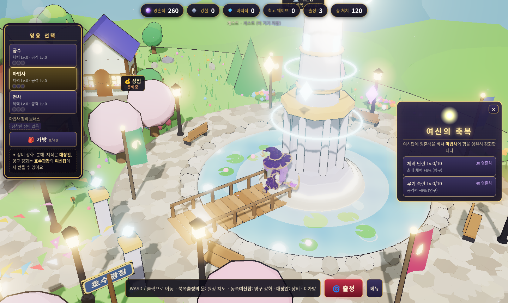
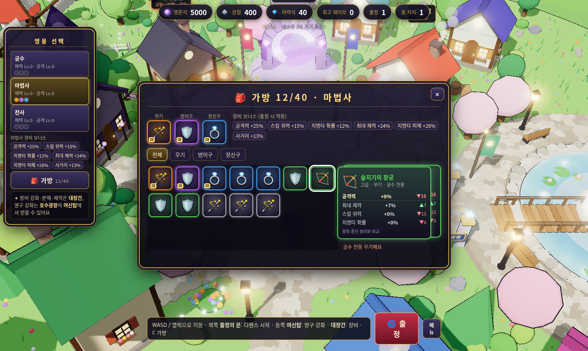
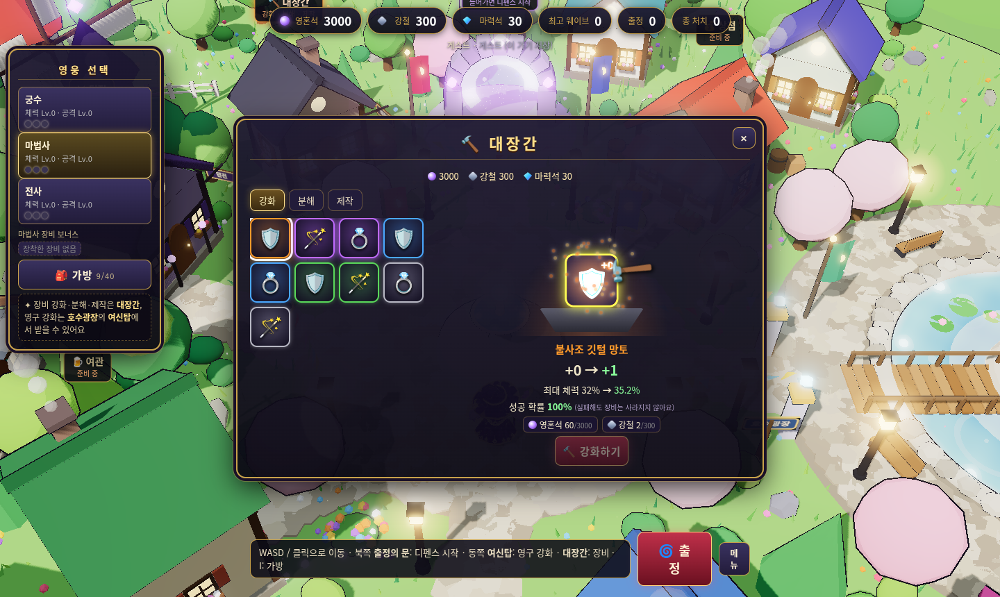
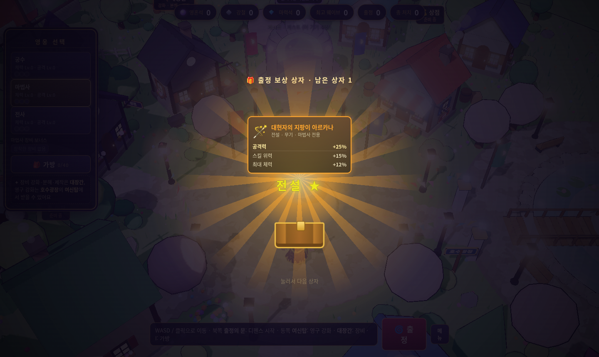
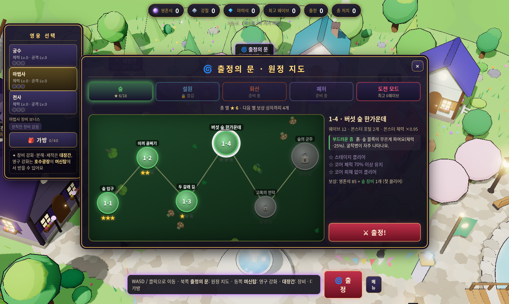
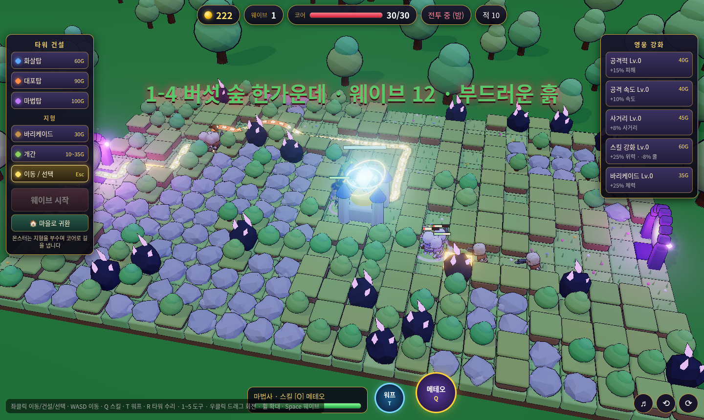
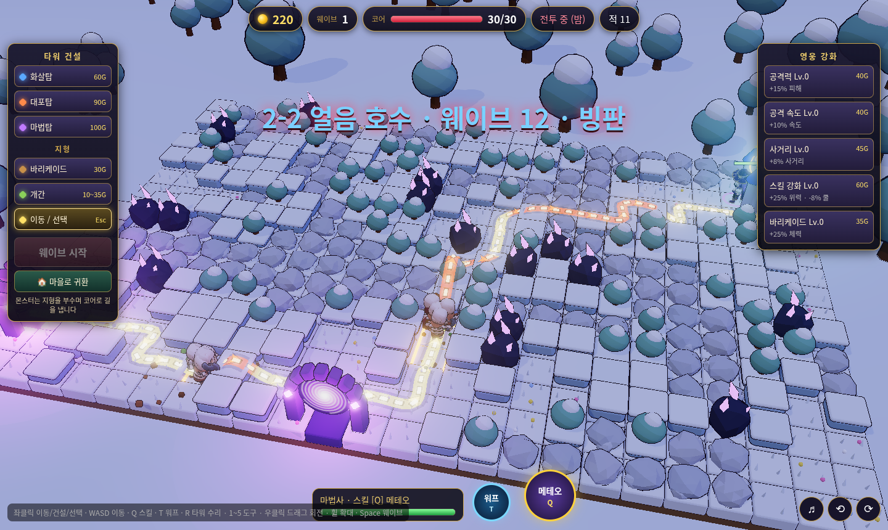

# 판타지 디펜스

Three.js(로컬 번들, CDN 없음)로 만든 쿼터뷰 3D 웹 디펜스 게임.

**플레이:** https://hyunjk11.github.io/hero-defense-3d/

## 게임 방식
- 맵 전체가 **파괴 가능한 지형**(흙더미·숲·바위, 일부 파괴 불가 암반)으로 덮여 있습니다.
- 몬스터는 포털에서 나와 지형을 **부수고 파내며** 코어로 전진합니다(파기/내려치기 애니메이션, 파편).
  파낸 자리는 **참호 길**로 남아 다음 적들이 이용합니다.
- 경로 비용 = 거리 + 블록 체력. 이미 뚫린 길이 더 싸면 그 길을, 아니면 새로 팝니다(다익스트라 거리장).
- **타워(골드)**: 빈 잔디 칸에 건설 · 3단계 업그레이드(단계마다 외형 변화) · 판매(70% 환급)
  - 화살탑: 빠른 단일 공격(공중 가능) · 대포탑: 포물선 포탄 범위 피해 · 마법탑: 연쇄 번개 + 둔화
- **바리케이드**: 뚫린 길 위에 설치해 적을 막는 장애물(적이 부수거나 돌아감)
- **개간**: 골드로 블록을 치워 타워 자리를 확보
- **영웅**(궁수/마법사/전사)을 직접 조종하며 싸움 · 스킬 Q · 사망 시 5초 후 부활
- 해골 도적/병사/기사, 유령 박쥐(비행), 5웨이브마다 해골 군주 보스
- **워프(T)**: 1초 채널링 후 코어 앞으로 순간이동(쿨다운 10초, 이동 시 취소) · 끼임 자동 탈출
- **다음 웨이브 미리보기**(건설 단계, 오른쪽 '영웅 강화' 아래): 몬스터 아이콘·이름·짧은 특성·예상 비율, 처음 보는 종류 NEW, 보스 줄. 화면이 좁으면 줄 수를 줄이거나 아이콘 한 줄
- **×2 배속 · 일시정지**(우하단 ❚❚ / ×1·×2 버튼, P / F 키): 배속은 같은 길이 스텝을 두 번 실행, 일시정지는 게임·입력을 멈추고 오버레이 표시(앱 전환 시 자동 정지). 판이 끝나면 ×1 로 돌아감
- 건설 미리보기: 고스트 타워·사거리·비용·불가 사유, 개간 블록 강조, 건설 가능 칸 격자, Esc/우클릭 취소
- 신규: 굴착병·돌격병·방패병·자폭병·공성병 (CHANGELOG.md 참고), 타워 체력·수리(R)
- 툰 셰이딩 + 외곽선, 블룸, 그림자, 낮(건설)/밤(전투), 파티클, 데미지 숫자, 코인 연출
- 몬스터 길 표시: 파낸 참호 바닥 발광 + 가장자리 빛 테두리, 예상 경로 리본(점선, 파야 할 구간은 주황), 코어로 흐르는 화살표
- HP 바: 영웅/적/보스/바리케이드/코어 공통 빌보드 바 (같은 왼쪽 기준점, 피해 잔상 바), 화면 상단 보스 체력 바
- 사운드: 건설(평화) / 전투(긴장) / 보스(격렬) BGM 크로스페이드, 공격·스킬·피격·파괴·채굴·코인·건설·강화·판매·웨이브 뿔나팔·보스 포효·코어 피격·게임오버 효과음
  - 우하단 ♪ 버튼에서 BGM/효과음 볼륨·음소거 따로 설정(localStorage 저장), M 키 전체 음소거. 첫 클릭/키 입력 때 오디오 시작

조작: 좌클릭 이동/건설/선택 · WASD 이동 · Q 스킬 · T 워프 · 1~5 도구 · 우클릭 드래그 회전 · 휠 확대 · Space 웨이브 시작 · P 일시정지 · F 배속 · Esc 취소 · M 음소거

## 챕터 · 스테이지 · 도전 모드
- 출정의 문 → 원정 지도. 1장 숲(6스테이지, 부드러운 흙·굴착병), 2장 설원(4스테이지, 빙판: 파인 길에서 몬스터 +30% 속도·돌격병), 3장 화산(4스테이지, 용암 강: 건널 수 없음·자폭병/공성병, 보스 화염의 군주), 4장 폐허(4스테이지 4-1 무너진 성문 · 4-2 이끼 낀 회랑 · 4-3 망령의 신전 · 4-4 망국의 왕좌, 고대 성벽: 바위 1.6배·무너지면 길이 바뀜, 포털 2→4개, 석상 가고일·폐허의 망령·폐허 덩굴, 보스 망국의 왕: 근위병 소환·타워 묶음 저주·50% 어둠의 파동)
- 스테이지마다 코어 위치·포털 수·지형이 다르고 10~15웨이브, 챕터 마지막은 보스
- 별 3개(클리어 / 코어 70%↑ / 코어 무피해), 별 5개마다 보상 상자, 첫 클리어 챕터 장비
- 도전 모드 = 기존 무한 웨이브 (최고 기록)

## 장비 · 대장간
- 영웅별 무기·방어구·장신구, 5등급(일반/고급/희귀/영웅/전설), 주 스탯 + 서브 스탯, 강화 +10
- 획득: 5웨이브마다 출정 보상 상자(오래 버틸수록 좋은 등급), 보스 50% 드롭(최소 고급), 대장간 제작
- 대장간: 강화(성공률 100·95·90·80·70·60·50·40·30·25%, 실패해도 파괴 없음, 비용 영혼석 20×(lv+1)×(1+등급×0.5) · 강철 2+2×lv · +5부터 마력석), 분해(일반 강철2 · 고급4 · 희귀8+마력석1 · 영웅12+3 · 전설20+8), 제작(기본 영혼석30·강철15 / 정교 80·40·마력석2 / 명장 200·80·8)
- 가방 40칸 (I 키), 장비 보너스는 출정 시 적용
- **보상 상자 보관함**: 판 보상은 미개봉 상자로 보관 → 마을 🎁 버튼에서 한 개씩 열기 / 10개 열기 / ✨ 모두 열기(등급순 요약 · 영혼석 합계 · 전설 반짝임). 가방이 가득 차면 들어가는 만큼만 열고 나머지는 보관

## 타워 성장 · 타워 연구소
- 출정한 판에서 타워가 피해/처치로 XP → ★★(600) → ★★★(2400), 별마다 피해·공속·사거리 상승과 외형 변화, ★★★에서 종류별 진화 2갈래 중 선택 (화살탑 연발 사수/저격수 · 대포탑 광역 폭발/단일 관통 · 마법탑 폭풍 연쇄/서리 결정)
- 마을 남쪽 **타워 연구소**: 타워 종류별 공격력·사거리·공격속도·시작 성장 영구 연구 (영혼석 + 강철/마력석)

## 계정 · 클라우드 저장 · 화면 흐름
인트로(세 영웅 3D 무대) → 로그인(이메일/비밀번호, 회원가입, 게스트) → 메인 메뉴(이어하기/새로 시작/설정/닉네임) → **마을**(걸어다니는 3D 마을: 돌길 광장·분수·집·풍차·깃발·가로등·반딧불·꽃잎, 영웅 선택, 던전·여관은 준비 중 · **상점**에서 유료 영웅 구매 신청 · 동쪽 **호수광장의 여신탑**에 다가가거나 클릭하면 **여신의 축복** 창에서 영혼석으로 영구 강화) → **출정의 문**으로 기존 디펜스 시작 → 패배/귀환 시 보상(영혼석 = 웨이브×8 + 처치/3)을 저장하고 마을로.
- Supabase(cart-race와 같은 프로젝트)의 `hd3d_profiles`, `hd3d_progress` 테이블 사용. **최초 1회 `supabase/schema.sql`을 Supabase SQL Editor에서 실행해야** 클라우드 저장이 켜집니다(실행 전에는 '서버 준비 중' 표시 + 이 기기에 저장).
- **상점 · 우편함 · 관리자** (`supabase/schema.sql`을 다시 실행하면 `hd3d_orders`·`hd3d_mail`·`hd3d_owned`·`hd3d_admins` 테이블과 RLS·RPC가 생깁니다. 실행 전에는 상점/우편/관리자 창에 '서버 준비 중' 표시)
  - 마을 동쪽 💰 **상점**: 첫 상품 = 유료 영웅 **로즈 · 총사** (회전 3D 미리보기). 가격·입금 안내 문구는 `src/config/shop.js`의 `ROSE_PRICE`(기본 ₩9,900)·`PAY_INFO`에서 변경
  - 흐름: **구매 신청**(pending, 실제 결제 연동 없음) → 관리자 결제 확인·**승인** → 서버가 **우편** 발송 → 플레이어가 ✉ **우편함**에서 '받기' → 서버 `hd3d_owned`에 기록되어 로즈 해금. 게스트 구매 불가, 대기 중 중복 신청·보유 상품 재구매는 서버(유니크 인덱스·트리거)에서도 차단, 받기는 한 번만(원자적 RPC)
  - 소유권은 서버 `hd3d_owned`(사용자 쓰기 권한 없음)에서만 읽고 세이브/localStorage에는 저장하지 않음 → 세이브를 고쳐도 해금 불가
  - 🛡 **관리자** 버튼(메뉴·마을)은 hyunjk11@daum.net 계정에만 표시. 구매 신청 목록 승인/거절 + 우편 보내기(영혼석·강철·마력석·영웅). 권한은 서버 `hd3d_is_admin()`(JWT 이메일 + `hd3d_admins` 고정 id)이 RLS/RPC에서 검사 → hyunjk11@daum.net으로 **가입한 뒤** schema.sql을 실행(또는 재실행)해야 관리자 권한이 생김
- **첫 로딩(지연 로딩)**: 스테이지 출정은 몬스터 + 저장된 영웅 모델만, 인트로·마을은 저장된 영웅만 먼저 받고 나머지 영웅·몬스터는 백그라운드로 (첫 방문 약 14 MB → 4.6 MB). `?test`/`?skipintro`는 전부 먼저 받음(`?lazy`로 지연)
- **버들(메카닉) 임시 숨김**: `src/data/heroes.js`의 `hidden: true` 하나로 선택·마을·상점·모델 로딩·새 무기 드롭에서 빠지고, 저장 영웅이 버들이면 실바(궁수)로 바뀝니다. 서버 소유권·주문·아이템은 그대로라 플래그를 지우면 복구됩니다
- 저장은 디바운스 + 오프라인 재시도, 기기에서 첫 로그인 시 게스트 진행을 병합. `?test`/`?skipintro`는 기존 영웅 선택 화면으로 바로 시작.

## 크레딧
- 마을(집·풍차·호수광장·여신탑·나무·꽃·파티클·물 셰이더)은 외부 에셋 없이 코드로 절차적 생성 (`src/world/town.js`)
- 영웅 모델·애니메이션(궁수·마법사·전사·총사 로즈, 모두 여성 치비 캐릭터): **Meshy**로 생성한 AI 생성 에셋 (Image to 3D + 자동 리깅 + 애니메이션 라이브러리, meshopt 압축 + 1024 WebP, three.js MeshoptDecoder로 로드)
- 캐릭터·무기 모델: **KayKit Adventurers & KayKit Skeletons Character Packs** by Kay Lousberg
  (https://www.kaylousberg.com) — **CC0 1.0**. `models/`에 용량을 줄여 포함했습니다.
- 효과음: Kenney (https://www.kenney.nl) — RPG Audio, Impact Sounds, Interface Sounds, Sci-fi Sounds, Music Jingles, **CC0 1.0** (`audio/sfx/`, `audio/KENNEY_LICENSE.txt`)
- BGM (모두 **CC0**, OpenGameArt.org):
  - 건설 단계: "Town Theme RPG" by cynicmusic — https://opengameart.org/content/town-theme-rpg (`audio/bgm/town.mp3`)
  - 전투: "Battle Theme A" by cynicmusic — https://opengameart.org/content/battle-theme-a (`audio/bgm/battle.mp3`)
  - 보스: "Boss Battle Theme" by CleytonKauffman — https://opengameart.org/content/boss-battle-theme (`audio/bgm/boss.mp3`)
- 웨이브 뿔나팔·보스 포효·번개 지직 소리는 WebAudio로 직접 합성
- 엔진: [three.js](https://threejs.org) (MIT)
